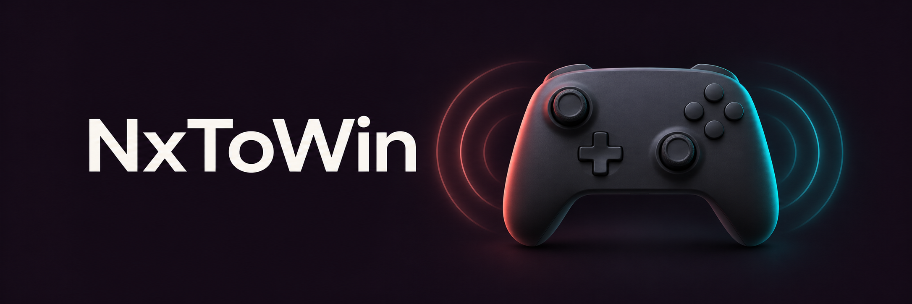
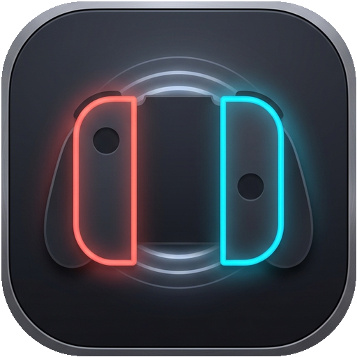
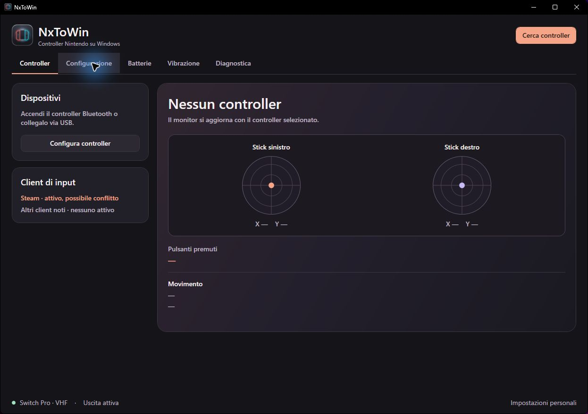
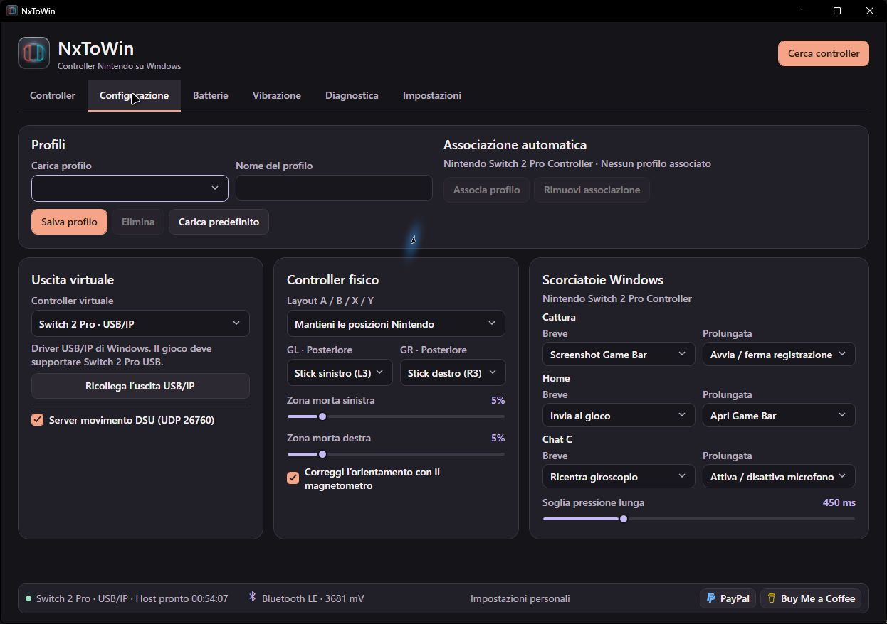

<div align="center">
  
  <br><br>
  
  <h1>NxToWin</h1>
  <p><strong>Usa i controller Nintendo Switch e Switch 2 nei giochi Windows.</strong><br>
  Input, movimento, mappatura per profilo e HD Rumble in un’app WPF.</p>
  <p>
    
    
    <a href="https://github.com/iCosiSenpai/nx-to-win/actions/workflows/windows.yml"></a>
  </p>
  <p><a href="#avvio">Avvio</a> · <a href="#integrazioni-e-driver">Integrazioni</a> · <a href="#configurazione">Configurazione</a> · <a href="#vibrazione">Vibrazione</a> · <a href="AUDIT.md">Audit</a></p>
</div>

| Monitor controller | Studio vibrazioni |
| :---: | :---: |
|  |  |

## Avvio

1. Installa [.NET 10 SDK](https://dotnet.microsoft.com/download/dotnet/10.0) su Windows 11 x64 e il driver dell’uscita che intendi usare.
2. Avvia NxToWin, accendi il controller o collegalo via USB e selezionalo nella scheda **Controller**.
3. In **Configurazione** scegli il controller virtuale atteso dal gioco.

```powershell
git clone https://github.com/iCosiSenpai/nx-to-win.git
cd nx-to-win
dotnet build NxToWin.slnx -c Release
dotnet run --project src/NxToWin -c Release --no-build
```

NxToWin instrada un controller alla volta. Può unire un Joy-Con sinistro e destro della stessa generazione. **×** rilascia un dispositivo, **Cerca controller** consente di ricollegarlo. La scheda **Batterie** mostra percentuale, livello a scatti o tensione in base alla sorgente, insieme al tipo di collegamento e allo stato di carica. Una coppia mantiene la lettura di entrambe le metà.

## Integrazioni e driver

| Uscita | Integrazione | Dati esposti al gioco |
| --- | --- | --- |
| Xbox 360 | [ViGEmBus](https://github.com/nefarius/ViGEmBus/releases) | XInput e feedback a due motori |
| DualShock 4 | [ViGEmBus](https://github.com/nefarius/ViGEmBus/releases) | Report DualShock 4, input e feedback |
| Switch Pro | [WinUHid](https://github.com/lurebat/WinUHid) | Report Switch Pro con movimento |
| Switch 2 Pro | [usbip-win2](https://github.com/vadimgrn/usbip-win2/releases) | Dispositivo USB composito 057E:2069, movimento e HD Rumble |
| DualSense | [WinUHid](https://github.com/lurebat/WinUHid) | Report DualSense con movimento |
| Xbox One | [WinUHid](https://github.com/lurebat/WinUHid) | Report HID Xbox One con feedback dei grilletti |
| Movimento DSU | [Cemuhook](https://github.com/v1993/cemuhook-protocol) | Accelerometro e giroscopio su UDP locale, porta 26760 |

NxToWin usa i driver già installati. Per USB/IP cerca `usbip.exe` in `%ProgramFiles%\USBip`. Il gioco deve supportare il profilo Switch 2. **Diagnostica → Verifica SDL3.dll** controlla se nella DLL del gioco sono presenti le stringhe del driver HIDAPI Switch 2 e di libusb. È disponibile anche l’uscita **Switch Pro · VHF**. [Driver Switch 2 in SDL](https://github.com/libsdl-org/SDL/blob/release-3.4.20/src/joystick/hidapi/SDL_hidapi_switch2.c)

La [matrice di compatibilità](docs/driver-compatibility.md) descrive i pulsanti e le funzioni di ogni uscita, le sorgenti batteria e le implementazioni esaminate per l’audio DualSense.

## Configurazione



- **Profili.** Carica uno dei nove preset per Pro Controller, Joy-Con singoli o in coppia e GameCube. Salva le tue varianti con un nome e associale ai dispositivi. La bozza corrente e i profili sono in `%LOCALAPPDATA%\NxToWin\profiles.json`.
- **Mappatura.** Personalizza A/B/X/Y, zone morte e pulsanti speciali. GL/GR compaiono con il Pro Controller 2, SL/SR con i Joy-Con. Il selettore del modello permette di preparare un profilo a controller spento.
- **Scorciatoie.** Scegli l’azione per la pressione breve e prolungata di Cattura e Home. Chat C compare se il controller fisico lo possiede e l’uscita selezionata è **Switch 2 Pro · USB/IP**. [Pulsanti Chat C su Nintendo Support](https://en-americas-support.nintendo.com/app/answers/detail/a_id/68390/)
- **Impostazioni dell’app.** Scegli Italiano o English, aggiorna automaticamente le batterie e imposta l’apertura massimizzata. La home include il comando **Riavvia Steam con -nojoy**. La barra inferiore mostra uscita, connessione, batteria e profilo, con pulsanti [PayPal](https://paypal.me/AlessioCosi) e [Buy Me a Coffee](https://buymeacoffee.com/icosisenpai).

## Vibrazione

Il bridge converte i motori tradizionali dei giochi Windows in due bande e inoltra fino a tre campioni HD per lato sui controller Switch 2. In **Vibrazione** trovi il cursore **Intensità vibrazione** del profilo, i misuratori dei motori e i test aptici. Sul GameCube è disponibile l’impulso del motore.

**Ninna nanna di Zelda**, **Canzone del tempo** e **Canzone delle tempeste** durano rispettivamente circa 26, 26 e 20 secondi. Mantengono l’incipit dell’ocarina e proseguono con frasi tratte dal tema della Principessa Zelda, dal Tempio del Tempo e dal Mulino. Il **Tema eroico di Zelda** segue la voce principale di Overworld in Sol a 100 BPM e dura circa 26 secondi. **Interrompi test** termina l’anteprima. [Dati ritmici di Ocarina of Time](https://github.com/zeldaret/oot/blob/main/src/audio/game/general.c#L860-L899) · [Spartito Nintendo del tema principale](https://images.thomann.de/pics/atg/atgdata/document/example/0038601_2.pdf)

## Sviluppo

```powershell
dotnet run --project tests/NxToWin.ProtocolChecks -c Release
```

La suite verifica descrittori USB e WinUSB, report e calibrazione, batterie, vibrazione, scorciatoie, giroscopio e lo scambio UDP DSU. La matrice delle prove e i casi hardware ancora da verificare sono nell’[audit](AUDIT.md). Le dipendenze native e i relativi avvisi di licenza sono in [drivers](drivers/README.md).

<div align="center"><sub>Progetto indipendente · Nintendo, Xbox e PlayStation sono marchi dei rispettivi titolari.</sub></div>
