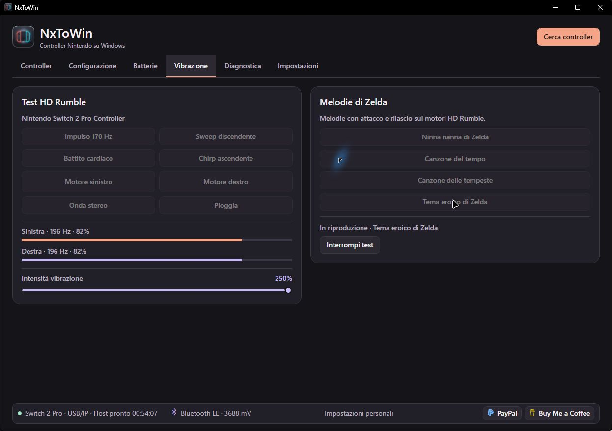

<div align="center">
  
  <br><br>
  
  <h1>NxToWin</h1>
  <p><strong>I tuoi controller Nintendo, nei tuoi giochi per PC.</strong><br>
  Collega Pro Controller e Joy-Con, scegli l’uscita per il gioco e personalizza pulsanti, movimento e HD Rumble.</p>
  <p>
    <a href="https://github.com/iCosiSenpai/nx-to-win/releases/latest/download/NxToWin-Setup.exe"></a>
  </p>
  <p>Windows 11 · x64 · Installazione per utente · Runtime incluso</p>
  <p><a href="#primo-avvio">Primo avvio</a> · <a href="#compatibilità">Compatibilità</a> · <a href="#personalizza-il-controller">Personalizza</a> · <a href="https://github.com/iCosiSenpai/nx-to-win/releases/latest">Ultima versione</a></p>
</div>

## Plugin e integrazioni

Scegli il profilo virtuale che il gioco riconosce. Installa il driver corrispondente dai link ufficiali.

| [ViGEmBus](https://github.com/nefarius/ViGEmBus/releases) | [WinUHid](https://github.com/lurebat/WinUHid) | [USB/IP](https://github.com/vadimgrn/usbip-win2/releases) | [DSU](https://github.com/v1993/cemuhook-protocol) |
| :--- | :--- | :--- | :--- |
| **Xbox 360 e DualShock 4**<br>XInput per i giochi PC o profilo PlayStation. | **Xbox One, DualSense e Switch Pro**<br>Uscite HID, ognuna con le proprie impostazioni. | **Switch 2 Pro**<br>Profilo USB nativo per i giochi compatibili. | **Movimento**<br>Giroscopio e accelerometro per emulatori e client DSU. |

| Controller in tempo reale | Vibrazione e melodie |
| :---: | :---: |
|  |  |

## Primo avvio

1. **Scarica e avvia** [NxToWin-Setup.exe](https://github.com/iCosiSenpai/nx-to-win/releases/latest/download/NxToWin-Setup.exe). Apri NxToWin dal menu Start.
2. **Collega il controller.** Usa il cavo USB oppure associalo in **Impostazioni di Windows → Bluetooth e dispositivi**. In NxToWin premi **Cerca controller** se necessario.
3. **Scegli l’uscita.** In **Configurazione → Controller virtuale**, seleziona il profilo atteso dal gioco. Per i giochi che richiedono XInput scegli **Xbox 360** con ViGEmBus.
4. **Avvia il gioco.** La barra in basso indica lo stato dell’uscita, la connessione, la batteria e il profilo attivo.

## Compatibilità

| Controller Nintendo | Funzioni |
| :--- | :--- |
| **Pro Controller e Pro Controller 2** | Stick, movimento, HD Rumble e batteria. Il Pro 2 espone anche GL, GR e Chat C nelle configurazioni compatibili. |
| **Joy-Con e Joy-Con 2** | Uso singolo o in coppia della stessa generazione, batteria per ciascun lato e mouse ottico sui Joy-Con 2. |
| **GameCube per Switch 2** | Pulsanti, grilletti e test del motore. |

La scheda **Batterie** può mostrare anche il livello di controller Xbox, PlayStation e altri gamepad quando Windows o il dispositivo lo forniscono. Per ogni lettura, l’app indica percentuale, fascia o tensione e lo stato di ricarica quando disponibile.

## Personalizza il controller


- **Profili.** Usa **Carica predefinito** per il modello connesso o scegli uno dei nove preset. Salva le tue regolazioni e associa il profilo al dispositivo.
- **Pulsanti.** Personalizza il layout A/B/X/Y e le zone morte. Le scorciatoie disponibili seguono il controller fisico e l’uscita selezionata. Chat C compare con un pulsante compatibile e l’uscita **Switch 2 Pro · USB/IP**.
- **Vibrazione.** Regola l’intensità del profilo, prova i due motori e riproduci quattro melodie aptiche di Zelda.
- **Impostazioni.** Scegli italiano o inglese e regola l’avvio della finestra e l’aggiornamento delle batterie.

## Aggiornamenti

Apri **Impostazioni → Aggiornamenti**. **Verifica aggiornamento** cerca una nuova versione e permette di installarla con **Installa e riavvia**. Se attivi **Aggiornamenti automatici**, NxToWin scarica le versioni in background e le installa alla chiusura. Puoi disattivare l’opzione in qualsiasi momento.

## Risoluzione dei problemi

<details>
<summary>Windows mostra un avviso per l’installer</summary>

Windows può chiedere conferma quando un installer appena pubblicato è privo di firma Authenticode. Il download ufficiale è nella [release GitHub](https://github.com/iCosiSenpai/nx-to-win/releases/latest), insieme al file SHA-256. Le istruzioni per verificare l’attestazione sono in [Sviluppo e distribuzione](#sviluppo-e-distribuzione). [Microsoft SmartScreen](https://learn.microsoft.com/windows/apps/package-and-deploy/smartscreen-reputation)

</details>

<details>
<summary>Il gioco non rileva il controller o riceve input doppi</summary>

Controlla che l’uscita scelta sia attiva e corrisponda al profilo supportato dal gioco. Se Steam sta acquisendo il controller, puoi usare **Controller → Client di input → Riavvia Steam con -nojoy**.

</details>

<details>
<summary>Il gioco supporta il profilo Switch 2 Pro?</summary>

L’uscita **Switch 2 Pro · USB/IP** richiede il driver [usbip-win2](https://github.com/vadimgrn/usbip-win2/releases) e il supporto del gioco per il controller USB. Se il gioco include SDL3, **Diagnostica → Verifica SDL3.dll** controlla la presenza del supporto. Consulta la [matrice dei driver](docs/driver-compatibility.md) per movimento, vibrazione e funzioni specifiche.

</details>

<div align="center">
  <p><strong>Sostieni NxToWin</strong><br><a href="https://paypal.me/AlessioCosi">PayPal</a> · <a href="https://buymeacoffee.com/icosisenpai">Buy Me a Coffee</a> · <a href="https://github.com/iCosiSenpai/nx-to-win/issues">Segnala un problema</a></p>
</div>

## Sviluppo e distribuzione

<details>
<summary>Compilazione, test e creazione dell’installer</summary>

Per lavorare sul sorgente usa Windows 11 x64, [PowerShell 7](https://learn.microsoft.com/powershell/scripting/install/installing-powershell-on-windows) e [.NET 10 SDK](https://dotnet.microsoft.com/download/dotnet/10.0).

```powershell
dotnet build NxToWin.slnx -c Release
dotnet run --project tests/NxToWin.ProtocolChecks -c Release --no-build
./scripts/package-windows.ps1
```

Su GitHub apri [Actions → Windows installer](https://github.com/iCosiSenpai/nx-to-win/actions/workflows/release-windows.yml), premi **Run workflow** e scarica l’artefatto dalla pagina del run. Per pubblicare una nuova versione, imposta `<Version>` in `NxToWin.csproj`, invia il commit a `main` e spunta **Publish this version to GitHub Releases**. Il workflow pubblica installer, pacchetto di aggiornamento e `SHA256SUMS.txt` dopo i test.

Le release immutabili hanno un’attestazione di GitHub. Per verificare la provenienza di un installer scaricato, usa `gh release verify-asset ./NxToWin-Setup.exe -R iCosiSenpai/nx-to-win`. Gli aggiornamenti dell’app usano il digest SHA-256 del pacchetto pubblicato da GitHub. [Verifica delle release immutabili](https://docs.github.com/en/code-security/how-tos/secure-your-supply-chain/secure-your-dependencies/verify-release-integrity)

[Audit e prove hardware](AUDIT.md) · [Driver e licenze](drivers/README.md) · [Build Windows](https://github.com/iCosiSenpai/nx-to-win/actions/workflows/windows.yml)

</details>

<div align="center"><sub>Progetto indipendente · Nintendo, Xbox e PlayStation sono marchi dei rispettivi titolari.</sub></div>
